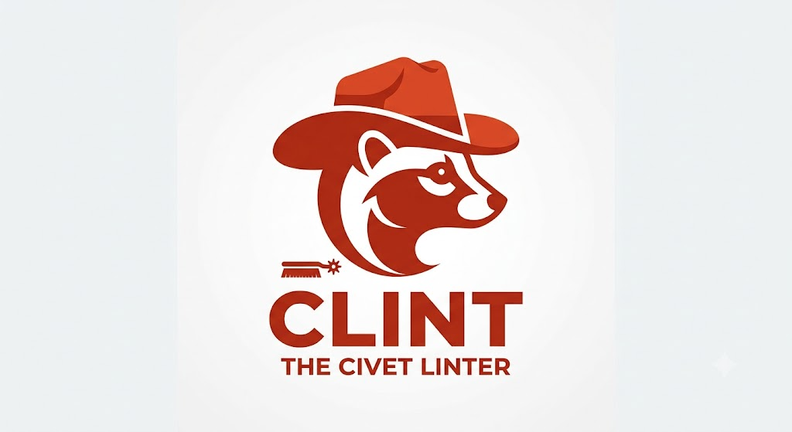

<p align="center">
  
</p>

# civet-clint

[](https://github.com/shogi-dojo/civet-clint/actions/workflows/ci.yml)
[](https://www.npmjs.com/package/civet-clint)
[](https://opensource.org/licenses/MIT)

A linter and autofixer for [Civet](https://civet.dev) that turns code into its most
compact idiomatic form. Every fix is compiled before and after, and kept only if the
output is the same ([how that works](https://github.com/shogi-dojo/civet-clint/blob/main/docs/how-it-works.md)).

```js
// before
const user = users.find((u) => u.id === id);
if (!user.roles.includes("admin")) {
  console.log(this.name, user.name.length);
}
```

```civet
// after `clint fix`
user := users.find((u) => u.id is id)
unless "admin" is in user.roles
  console.log @name, user.name#
```

## Install

```bash
npm install --save-dev civet-clint
```

## Use

```bash
npx clint            # report problems
npx clint fix        # apply the verified fixes
npx clint convert    # turn JS/TS files into Civet
npx clint config     # show the resolved configuration
```

Add a `clint.config.json` to choose a preset:

```json
{ "preset": "civet-idiomatic" }
```

| Preset | For |
|---|---|
| `default` | A few safe basics: word operators, concise arrows, no trailing semicolons. |
| `civet-idiomatic` | The full modern Civet style guide. |
| `coffee-react` | Civet + React with CoffeeScript-style options (`autoLet`, `#` comments, `isnt`). |
| `coffee-to-standard` | Migrating off the CoffeeScript options toward standard Civet. |

Clint uses your project's `@danielx/civet` (it bundles `0.11.16` as a fallback) and
reads your `civet.json`.

## Docs

- [Command line](https://github.com/shogi-dojo/civet-clint/blob/main/docs/cli.md): commands, options, exit codes
- [Configuration](https://github.com/shogi-dojo/civet-clint/blob/main/docs/configuration.md): rules, overrides, exceptions, compiler
- [Presets](https://github.com/shogi-dojo/civet-clint/blob/main/docs/presets.md): what each preset enables
- [Rules](https://github.com/shogi-dojo/civet-clint/blob/main/docs/rules.md): all 51 rules, and what each will not touch
- [Migrating from JS/TS](https://github.com/shogi-dojo/civet-clint/blob/main/docs/migrating.md): `clint convert` and what to check after it
- [How it works](https://github.com/shogi-dojo/civet-clint/blob/main/docs/how-it-works.md): the equivalence gate and output deltas
- [API and plugins](https://github.com/shogi-dojo/civet-clint/blob/main/docs/api.md): using clint from Node, writing rules
- [Compatibility](https://github.com/shogi-dojo/civet-clint/blob/main/docs/compatibility.md): Node, Civet versions, dialects
- [Changelog](https://github.com/shogi-dojo/civet-clint/blob/main/CHANGELOG.md)

## License

MIT © [shogi-dojo](https://github.com/shogi-dojo)
