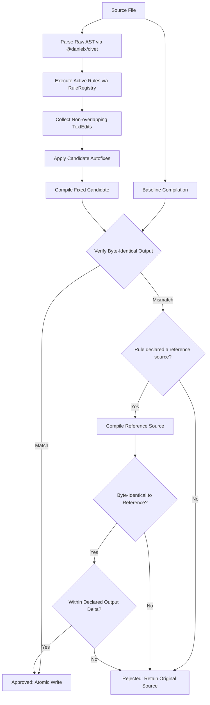

# How it works

Clint parses with the official `@danielx/civet` compiler, not regexes. Every fix is
checked by compiling the file before and after: by default the emitted JS/TS must be
byte-for-byte identical, or the fix is thrown away. Changes are written atomically and
keep the file's line endings.

Fixes are validated per rule, one batch per file, so a rejected rule never discards
another rule's approved edits.

The reference-source branch is the exception to comparing against the original file's
output. It is how a rule whose fix cannot be byte-identical is verified: the opt-in
[`unquoteSingleQuotes`](rules.md#styleprefer-terse-imports), brace removal in
`style/prefer-implicit-object-arg` (`whitespace-style`), and the `f (=> x)` form of
`style/prefer-implicit-arrow-arg` (`arrow-paren-style`, declared only when such a site
is fixed), and guard-clause tails in `style/prefer-implicit-return` (`conditional-return`). Every delta kind is listed in the
[compatibility matrix](compatibility.md#compiler-equivalence--output-deltas).
It does not relax the gate, because it is paired with an engine-owned bound on the
emitted difference. A rule
supplies the reference *source*; the engine defines what each delta kind permits and
verifies it separately, so a rule cannot widen its own allowance or launder an
arbitrary rewrite through a broad reference. A rule never inspects, normalizes, or
approves compiled output. Rules that declare no reference are governed solely by the strict check against the
original.

For design details regarding AST constraints, compiler dials, and upstream Civet integration, see [docs/upstream.md](upstream.md).
